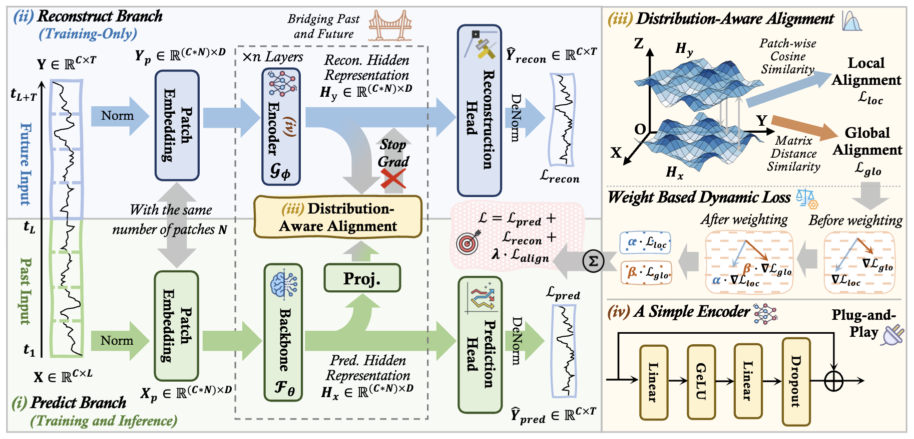

# Proposição de aprimoramento do framework plug-and-play *TimeAlign* através de exploração prática na mitigação de efeitos por divergência entre futuro e passado em confronto à abordagem da referência

Exploração realista e de impactos do *TimeAlign*

## 🚩Proposta de Projeto

A previsão de séries temporais multivariadas sofre com a não-estacionariedade, caracterizada pela divergência estatística entre o comportamento passado e o horizonte futuro. O framework plug-and-play *TimeAlign* busca mitigar essas discrepâncias ao alinhar representações temporais sem alterar os modelos preditivos subjacentes, mas ainda apresenta limitações diante de mudanças abruptas de regime. Este trabalho propõe uma análise realista da performance do *TimeAlign* e um aprimoramento prático em seu mecanismo de alinhamento para reduzir os efeitos da divergência temporal.

A metodologia envolve experimentos comparativos controlados em *benchmarks* de séries temporais, confrontando a abordagem proposta com o *TimeAlign* original e baselines da literatura via MSE e MAE. Espera-se obter ganhos de acurácia e estabilidade, evidenciando o potencial da extensão em contextos gerais.

## 🌟 Visão Geral do Método Promovido

*TimeAlign* é um *framework* leve e de mecanismo associável que busca conectar a diferença de distribuição em problemas de séries temporais, alinhando representações do passado (treino) e do futuro (teste) através de uma tarefa de alinhamento reconstrutivo. A implementação oficial desse alinhamento está localizada em `./layers/Alignment.py`.
*(Seção adaptada da documentação oficial do [TimeAlign](https://github.com/TROUBADOUR000/TimeAlign))*



## 🛠 Pré-requisitos

Ensure you are using Python 3.10.18 and install the necessary dependencies.
*(Seção adaptada da documentação oficial do [TimeAlign](https://github.com/TROUBADOUR000/TimeAlign))*

## ⬅️📊 Preparação dos Datasets Básicos

Comece fazendo o *download* das bases de dados tradicionais utilizadas no artigo referência e no início do atual projeto. Esses *datasets* estão disponíveis em [iTransformer](https://drive.google.com/file/d/1l51QsKvQPcqILT3DwfjCgx8Dsg2rpjot/view?usp=drive_link). Você deve criar uma pasta separada nomeada `./dataset` e organizar de forma ordenada todos, e apenas, os **arquivos csv** como mostrado a seguir:

```
dataset
└── electricity.csv
└── ETTh1.csv
└── ETTh2.csv
└── ETTm1.csv
└── ETTm2.csv
└── traffic.csv
└── weather.csv
└── solar_AL.txt
```

*(Seção adaptada da documentação oficial do [TimeAlign](https://github.com/TROUBADOUR000/TimeAlign))*

## 🛒📊 Preparação dos Datasets Novos

#### 1️⃣ Pedestrian Drift Counts

Base de dados que relata a contagem de pedestres registrados em ruas diferentes da cidade de Melbourne City. Os dados indicam registros desde 2009, mas é feito um corte de 2016 a 2021 para permitir a exploração com uma quantidade razoável de dados, presença de *concept drift* clara e significativa e trata de acontecimentos do mundo real. O *dataset* deve ser baixado no site [forecasting](https://forecastingdata.org) e precisa de um tratamento antes de aplicado, que será executado a partir do arquivo já presente no repositório.

- Após baixar o arquivo da série temporal e extraí-lo, mova o arquivo (atualmente nomeado *<u>pedestrian_counts_dataset.tsf</u>*) para a mesma pasta  `./dataset` e;
- Com o arquivo localizado, na raiz do projeto, execute o comando no terminal  `python converte_tsf.py`, para que o arquivo seja corretamente convertido em .csv nos intervalos e colunas corretos.

*Obs: Após isso, o arquivo .tsf pode ser removido do projeto*


## 💻 Treinamento

Os scripts estão localizados em `./scripts`. Para treinar um modelo com uma base, simplesmente rode:

```shell
bash ./scripts/nome_dataset.sh
```

Depois do treinamento:

- O modelo treinado estará armazenado em `./checkpoints`.
- Resultados numéricos no formato .npy ficarão em `./results`.
- Um sumário de resumo compreensível estará salvo em `./result.txt`.

## 📚 Citação

Citação do artigo referência base para o projeto atual:

```bibtex
@article{hu2025bridging,
  title={Bridging Past and Future: Distribution-Aware Alignment for Time Series Forecasting},
  author={Hu, Yifan and Yang, Jie and Zhou, Tian and Liu, Peiyuan and Tang, Yujin and Jin, Rong and Sun, Liang},
  journal={arXiv preprint arXiv:2509.14181},
  year={2025}
}
```

## 🙏 Agradecimentos

## 📩 Contato

#### 👥 Equipe

| **Nome Integrante**             | **login CIn** |
| :------------------------------------ | :-----------------: |
| Felipe Almeida Albuquerque de Holanda | ***faah*** |
| Guilherme Galindo Zloccowick          |  ***ggz***  |
| Kaynan Roberth Torres Silva           | ***krts*** |

#### 📝 E-Mail

***{faah, ggz, krts}*@cin.ufpe.br**
